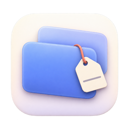
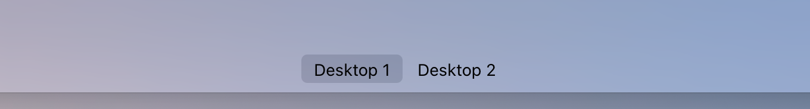
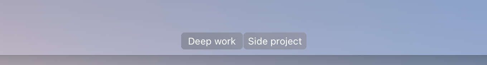

<p align="center">
  
</p>

<h1 align="center">Nametag</h1>

<p align="center">Name your Mac desktops. Right in Mission Control, where you actually look for them.</p>

<p align="center">
  <br>
  <sub>before</sub><br><br>
  <br>
  <sub>after</sub>
</p>

## Why I built this

I organize my Mac by desktops. One for what I'm working on right now, one for the thing I swore I'd
get back to, one for the rabbit hole I opened at 1am. Desktops are where I park stuff "for later",
and that system only works if I can tell them apart.

macOS, frustratingly, won't let you rename them. So I built my own. It's not perfect, but it gets the
job done: swipe up, see your names. Long-press a label, type a new one. Done.

If you're the kind of person who keeps things organized but leaves half of it open "to do later",
you've probably hit this exact wall too. This one's for us.

## What it does

- **Your names, in Mission Control.** They sit right on top of Apple's labels and match their look,
  so it feels built in.
- **Rename on the spot.** Long-press a label in Mission Control, type, hit Return (Esc cancels).
  A quick click still switches desktops like normal.
- **Menu bar too.** The tag icon shows the desktop you're on. Click it to see all your desktops and
  rename any of them, or press **⌃⌥N** to rename the current one from anywhere.
- **Stays out of the way.** One switch turns it off. Launch at login if you want it always there.

## Install

There's no download yet (a notarized release and a Homebrew cask are next). For now, build it:

```bash
git clone https://github.com/elbionredenica/nametag.git
cd nametag
./scripts/build-app.sh
open build/Nametag.app
```

Needs macOS 13+ and Xcode. On first launch Nametag asks for **Accessibility** access. Turn it on in
System Settings → Privacy & Security.

**What that permission is for, exactly:** reading where Mission Control draws its "Desktop" labels,
following your three-finger swipes (swipe gestures only), and catching your typing while you rename
something inside Mission Control, because Mission Control swallows keystrokes otherwise. Nametag
doesn't read your windows and doesn't send anything anywhere.

## Rough edges

This is v0.1 and I'd rather tell you than have you find out:

- When you swipe sideways between desktops inside Mission Control, the names step aside and come
  back once the swipe settles.
- When you swipe down while the thumbnails are showing, the names stay put until the gesture ends.
- Tested on macOS 27 with one display. Multiple displays should work but haven't been tried.
- Full-screen app spaces keep their app names.
- If the names drift during swipes on your Mac, open an issue.

## Contributing

Issues and PRs are very welcome, especially if you run multiple displays or a different macOS
version. Screen recordings of anything that looks off help a lot.

## License

MIT
